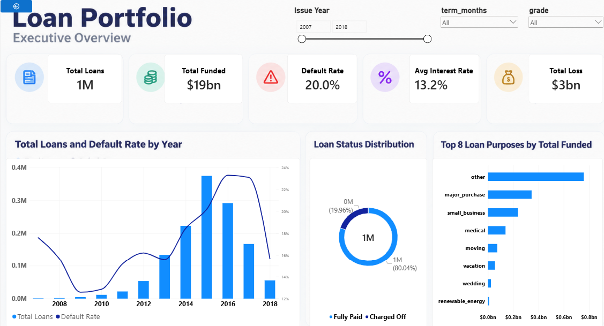
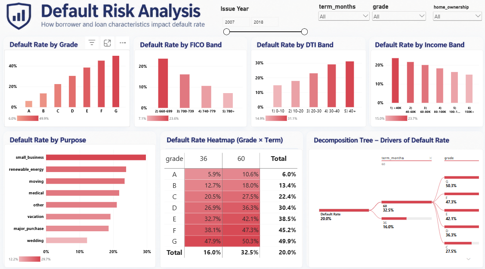
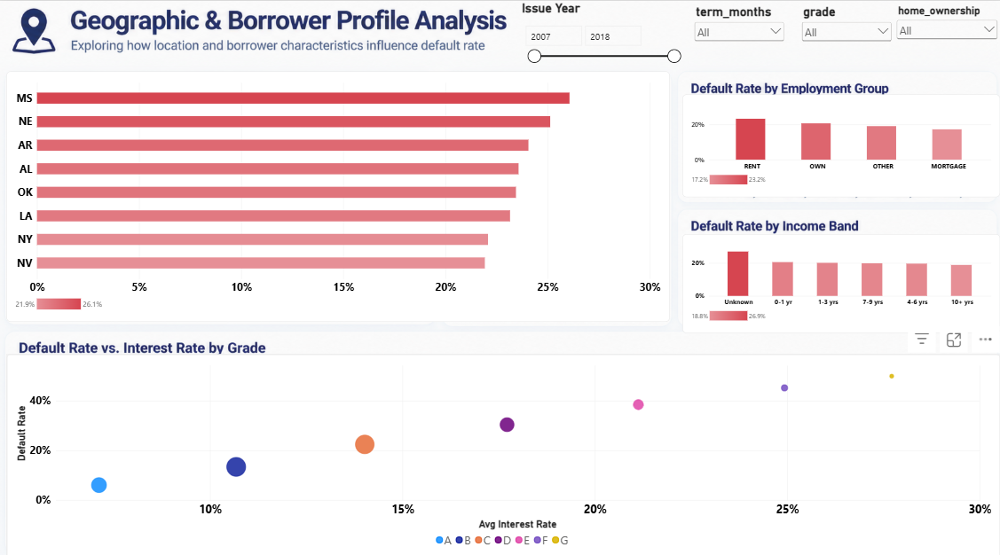

# Lending Club Loan Default Risk: Who Defaults and Why

Analysis of about 1.3M resolved Lending Club loans (2007 to 2018 Q4) using Python and Power BI.

## Business questions
1. How big is the loan portfolio and how has default changed over time?
2. Which loan and borrower traits (grade, term, FICO, DTI, income, purpose) are linked to default?
3. Do interest rates keep up with risk, and where are losses concentrated?

## Key findings
20.0% of resolved loans were charged off, costing an estimated $3bn in lost principal on $19bn funded
Default rate rises from 6.0% in Grade A to 49.9% in Grade G
60-month loans default at 32.5% vs 16.0% for 36-month loans
Borrowers with FICO 660-699 default at 23.6% vs 7.1% for 780+
DTI above 40 defaults at 31.1% vs 14.9% for DTI under 10
Small business loans have the highest default rate by purpose (29.7%)
Mississippi has the highest default rate by state (26.1%), and renters default at 23.2% vs 17.2% for mortgage holders
From Grade A to G the average interest rate rises about 4x (roughly 7% to 28%), but the default rate rises about 8x

## Recommendations
1. Tighten approval rules for 60-month loans in lower grades
2. Review pricing for grades where losses outpace interest income
3. Add DTI and FICO checks for the riskiest loan purposes
4. Monitor high-default states and issue-year cohorts more closely

## Tools
Python (pandas) for cleaning, Power BI for modeling and dashboards, DAX for measures

## Data cleaning (src/clean_lending_club.py)
| Issue | Action |
|---|---|
| About 150 columns in the raw file | Kept the 24 needed |
| Loans still in progress (Current, Late, Grace Period) | Removed, no final outcome yet |
| Dates stored as text | Converted to date |
| Missing dti, revol_util or annual_inc ([N] rows) | Removed |
| Income above 500K or zero, DTI outside 0-60 | Removed as outliers |
| revol_util above 100 | Capped at 100 |
| Missing employment length | Labeled "Unknown" |
| Home ownership "ANY" and "NONE" | Merged into "OTHER" |
| No default column | Created default_flag (1 = Charged Off) |
| No loss column | Created loss_amount (funded amount minus principal repaid, defaulted loans only) |

## Dashboard

## How to reproduce
1. Download the Lending Club dataset (accepted loans) from Kaggle into `data/raw/`
2. `pip install pandas numpy`
3. `python src/clean_lending_club.py`
4. Load `data/clean/lending_club_clean.csv` into Power BI (see `powerbi/loan.pbix`)

## Notes
- "Default" means a loan with status Charged Off. Fully Paid is the non-default group
- Loss amount is an estimate based on principal repaid, not Lending Club's reported loss
- Loss columns use post-loan information, so they are fine for this descriptive analysis but must not be used as features in a prediction model
- Patterns here show association, not proof of cause
